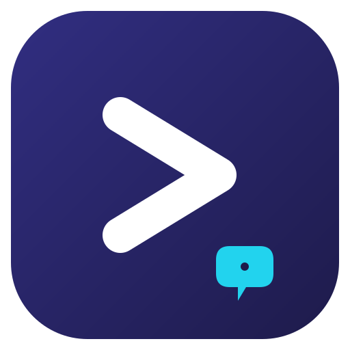

# nlsh

<p align="center">
  
</p>

<p align="center">
  <sub>The mark above is a hand-authored SVG, released under the same
  MIT license as the code.</sub>
</p>

A natural-language shell. You describe what you want in plain words, a model
turns it into shell commands, and nlsh checks the plan, shows it to you, and
runs it once you approve it.

```
$ nlsh "symlink the Designs folder to dist"

  Symlink ./Designs to ./dist.
  ! The target ./dist is assumed to exist.
  1. $ ln -s ./Designs ./dist  [careful]

  Run? [Y=run · n=cancel · e=edit] y

  $ ln -s ./Designs ./dist
```

Nothing runs until you say so. If you would rather edit the command first,
answer `e` and your `$EDITOR` opens with the plan in it.

On a Mac with Apple Intelligence the model is the one already built into your
machine: no API key, no cloud, no download. On any platform, point nlsh at
any OpenAI-compatible server.

---

## Contents

- [Requirements](#requirements)
- [Install](#install)
- [Using it](#using-it)
- [Shell integration](#shell-integration)
- [Choosing a model](#choosing-a-model)
- [How a plan is checked](#how-a-plan-is-checked)
- [The safety model](#the-safety-model)
- [Exit codes](#exit-codes)
- [Windows](#windows)
- [How it works](#how-it-works)
- [Development](#development)
- [Troubleshooting](#troubleshooting)
- [The Swift implementation](#the-swift-implementation)
- [License](#license)

---

## Requirements

Nothing at runtime. nlsh is a single static binary with no dependencies and
no configuration file.

It does need a model to talk to:

| | |
|---|---|
| macOS 26+ with Apple Intelligence | [apfel](https://github.com/Arthur-Ficial/apfel), which nlsh starts for you |
| Anything | Any OpenAI-compatible server: OpenAI, Ollama, LM Studio, vLLM, or your own |

## Install

**Install with Homebrew** (macOS and Linux):

```sh
brew tap CodeAndCanvas728/nlsh
brew install CodeAndCanvas728/nlsh/nlsh
```

Homebrew won't load a formula from a tap that isn't trusted — but
naming the formula on the command line, as above, is an exception: that
one formula loads even from an untrusted tap. The trust step is what lets
Homebrew load the tap's formulae by other routes — short-form
`brew install nlsh`, `brew search`, and the like:

```sh
brew trust CodeAndCanvas728/nlsh
```

If your Homebrew refuses even that, trust the formula directly:

```sh
brew trust --formula CodeAndCanvas728/nlsh/nlsh
```

(Tested on Homebrew 7.0.10: the full-name form loads from an untrusted
tap, and `--formula` is accepted as a fallback.)

**Or download a binary** from the
[releases page](https://github.com/CodeAndCanvas728/nlsh/releases). There is
one for macOS, Linux and Windows, on both amd64 and arm64.

```sh
tar -xzf nlsh-darwin-arm64.tar.gz
sudo mv nlsh /usr/local/bin/
```

**Or install with Go:**

```sh
go install github.com/CodeAndCanvas728/nlsh/cmd/nlsh@v0.3.1
```

**Or build it yourself:**

```sh
git clone https://github.com/CodeAndCanvas728/nlsh
cd nlsh
make build
```

## Using it

```sh
nlsh "find the three biggest files in this folder"
nlsh -n "list the files here"           # show the plan, run nothing
nlsh --print "list the files here"      # print the commands only
nlsh                                    # interactive, keeps the conversation
```

### Options

| option | what it does |
|---|---|
| `-y`, `--yes` | approve automatically, unless a command is destructive |
| `-f`, `--force` | never ask, not even for destructive commands |
| `-n`, `--dry-run` | show the plan, never execute it |
| `-p`, `--print` | print the commands only, with no prompts |
| `--timeout D` | give up on a command after D (`30s`, `5m`); `0` means no limit, which is the default |
| `--base-url URL` | the OpenAI-compatible endpoint to ask |
| `--api-key KEY` | bearer token to send with the request |
| `--model NAME` | the model to ask for |
| `--zsh-init` | print the zsh integration script |
| `-v`, `--version` | print the version |
| `-h`, `--help` | print the usage text |

### Options come before the request

The first word of the request ends the option parsing, because a request is
free text. An option in that position is reported rather than quietly
becoming part of the request:

```sh
$ nlsh "list files" --dry-run
nlsh: option --dry-run appears after the request; put all options before the request, or use -- to mark the end of the options
```

When the request itself contains something that looks like an option, use
`--`:

```sh
nlsh -- "remove files matching --force"
```

### Interactive mode

Running `nlsh` with no request starts a conversation. The model keeps the
earlier turns, so a follow-up has something to refer to:

```
nlsh > symlink the Designs folder to dist
nlsh > now make it read-only instead
```

`help` prints the usage, `exit` (or `quit`, `bye`) leaves.

## Shell integration

```sh
eval "$(nlsh --zsh-init)"
```

Add that to your `~/.zshrc`. Then type a request on your prompt and press
**Ctrl+O**: the generated command replaces the line you were typing, so you
can read it, edit it, and press Enter when you are happy. Nothing runs
before you press Enter.

Two functions are defined as well:

- `nls <request>` runs the plan the normal way — show it, ask, run.
- `nli <request>` puts the command in the buffer without running it.

`nli` captures the output of `nlsh --print`, which writes the commands to
stdout and everything else to stderr, so what lands in your buffer is only
the command. `nls` runs nlsh the normal way, so it shows the plan and asks
before running anything.

## Choosing a model

nlsh asks an OpenAI-compatible server for the plan:

| variable | flag | meaning |
|---|---|---|
| `NLSH_BASE_URL` | `--base-url` | the endpoint, for example `http://localhost:11434/v1` |
| `NLSH_API_KEY` | `--api-key` | bearer token; `OPENAI_API_KEY` also works |
| `NLSH_MODEL` | `--model` | the model to ask for |

### On-device, on a Mac

[apfel](https://github.com/Arthur-Ficial/apfel) serves Apple Foundation
Models over an OpenAI-compatible API. Install it once:

```sh
brew install apfel
```

Then point nlsh at it:

```sh
export NLSH_BASE_URL=http://localhost:11434/v1
export NLSH_MODEL=apple-foundationmodel
nlsh "what is taking up space on this disk"
```

If the endpoint is local and nothing is answering on it, nlsh starts
`apfel --serve` for you and waits for it. The server keeps running
afterwards, so later calls are instant.

nlsh checks that whatever is answering really is apfel. If something else
holds the port — Ollama usually does — nlsh says so instead of talking to
the wrong server.

### Ollama, LM Studio, or anything else

```sh
export NLSH_BASE_URL=http://localhost:11434/v1
export NLSH_MODEL=qwen2.5-coder:7b
```

### A hosted model

```sh
export NLSH_BASE_URL=https://api.openai.com/v1
export NLSH_API_KEY=sk-...
export NLSH_MODEL=gpt-5-mini
```

## How a plan is checked

Before you see a plan, nlsh checks it. These are heuristics: they catch the
obvious breakage, not mistakes of judgement.

- The command is not empty and its quotes balance.
- The program it runs exists, either in `PATH` or as a shell builtin.
- Every long option it uses appears in that tool's own help. For
  `git push --force` that means `git push --help`, not `git --help`.
- Every path you mentioned is used by some command.

If something is wrong, nlsh tells the model what was wrong and asks once for
a corrected plan. If the corrected plan still has problems, nlsh says so and
shows them next to the plan.

The checks are not proof. A command can pass every one of them and still be
the wrong command.

## The safety model

- **The plan is always shown before anything runs.**
- **Destructive commands need the word `yes`.** `-y` approves everything
  except destructive commands; `-f` skips even that. Careful.
- **The risk is never taken on trust.** The label the model gives is
  combined with nlsh's own detection, and the higher of the two wins. A
  command the model calls `safe` that turns out to be `rm -rf` is still
  shown as destructive.
- **Elevated privileges are refused, not approved.** A command that needs
  `sudo` is never run, because it would ask for a password that nobody can
  type. nlsh prints the command so you can run it yourself.
- **You can edit the plan.** Answer `e` and your editor opens with the
  commands in it. What you save is what runs.

The destructive patterns nlsh knows about are the ones that delete or
destroy: `rm` with something to delete or with `-r` or `-f`, `mkfs`, `dd`
with `of=`, `diskutil erase` and its neighbours, `git reset --hard`,
`git clean -f`, `git push --force`, `chmod -R 777`, `shred`,
`truncate -s 0`, piping a download into a shell, and `defaults delete`.
Each platform has its own list.

## Exit codes

| code | meaning |
|---|---|
| `0` | the request was handled, or was cancelled |
| `1` | no plan could be produced: no model configured, or the model failed |
| `2` | the plan was rejected: validation issues remained, or it needed elevated privileges |
| `124` | a command ran out of time (`--timeout`) |
| other | the exit status of the last command that ran |

That last row is what makes nlsh usable in a script: `nlsh "..."` fails when
the command it ran failed.

## Windows

Windows support is command line only. There is no shell integration: the
Ctrl+O buffer insertion is zsh.

nlsh asks the model for PowerShell rather than a POSIX shell, runs commands
with `powershell.exe -NoProfile -NonInteractive -Command`, and knows the
Windows ways of deleting things — `Remove-Item -Recurse -Force`, `del /s`,
`rd /s /q`, `reg delete`, `Clear-Content`.

## How it works

```
request
   │
   ├─ the model is asked for a plan, constrained by a JSON Schema
   │     so the answer always parses
   │
   ├─ the plan is checked: binaries, flags, quotes, paths
   │     └─ if something is wrong, the model is asked once to fix it
   │
   ├─ the risk of every command is worked out, by the model and locally
   │
   ├─ the plan is shown, and approved
   │
   └─ the commands run, one at a time, stopping at the first failure
```

The plan is requested with `response_format.json_schema`, so a compliant
server returns a plan in exactly the shape nlsh expects. Servers that do not
support it are retried with the looser `json_object` format.

## Development

```sh
make check      # gofmt, go vet, go test -race — this is what CI runs
make build      # build ./nlsh
make test       # tests only
make install    # go install
```

`make check` is the gate. `gofmt -l .` must print nothing.

### Layout

```
cmd/nlsh/            the command itself
  shells/zsh.sh      the zsh integration, embedded into the binary
internal/app/        plan → validate → approve → run
internal/backend/    the model client, and the apfel launcher
internal/cli/        the command line: options, and the usage text
internal/validate/   checking a plan
internal/guard/      deciding how risky a command is
internal/platform/   what differs between operating systems
internal/report/     what goes to stdout, and what goes to stderr
internal/run/        running the commands: timeouts, interrupts, exit codes
internal/shell/      parsing command lines
internal/plan/       the plan contract and its JSON Schema
```

There are no third-party dependencies. Everything is the Go standard
library.

### Tests

The validator, the risk classifier, the command-line parser and the
tokenizer are unit-tested. The whole pipeline — plan, validate, approve,
run — is tested end to end against a fake planner, so the tests never need a
model and never touch the network. The model client is tested separately,
against a fake OpenAI-compatible server.

The runner has tests of its own, because that is where the awkward parts
are: a command that runs out of time, one that forks and leaves the output
pipe held open, an interrupt arriving as a real signal, and a command killed
by a signal.

```sh
go test ./...
go test -race ./...
```

### CI

The checks run on Forgejo, in `.forgejo/workflows/ci.yaml`: format, vet,
test, the race detector and a build. The instance has an `ubuntu-latest`
runner and a `macos` one, which is a Mac, so the Darwin profile and the
zsh path are covered too. There is no Windows runner: Windows is
cross-built, not run.

The release is published by GitHub, from `.github/workflows/release.yaml`.
The repository reaches GitHub through a Forgejo push mirror, so a `v*` tag
pushed to Forgejo arrives on GitHub and the six binaries are published
there. That workflow cross-compiles every target on ubuntu and runs
`make check` first.

`docs/releasing.md` records how to cut a release and how to check that the
mirror and the two workflow directories are still set the way they are.

## Troubleshooting

**"no model configured"** — nlsh was not told where to find a model. Set `NLSH_BASE_URL` and `NLSH_MODEL`, or pass `--base-url` and
`--model`.

**"no model configured; set NLSH_MODEL or pass --model"** — the endpoint is
set but no model was named.

**"something else is already serving on http://localhost:11434/v1"** —
another server holds that port. Ollama usually does. Either stop it, use a
different port, or point `NLSH_BASE_URL` somewhere else.

**"model '...' not found"** — the server is answering but does not know that
model. Check `NLSH_MODEL` against what the server serves.

**"apfel is not installed"** — the endpoint is local, nothing is listening,
and nlsh cannot start the server itself. Install apfel with
`brew install apfel`, or point `NLSH_BASE_URL` at another server.

**The plan keeps changing** — the on-device model is small. Ask for one
thing at a time, and be specific about names and paths.

**A command is rejected as invalid** — nlsh asks the model once to fix it
and then shows you the remaining problems. The command is usually close to
right but uses a flag the tool does not have.

## The Swift implementation

`legacy/` holds the original implementation, written in Swift. It is kept
for reference while this port is validated and is not built by CI.
`legacy/README.md` lists what it still gets wrong.

## License

MIT. See [LICENSE](LICENSE).
